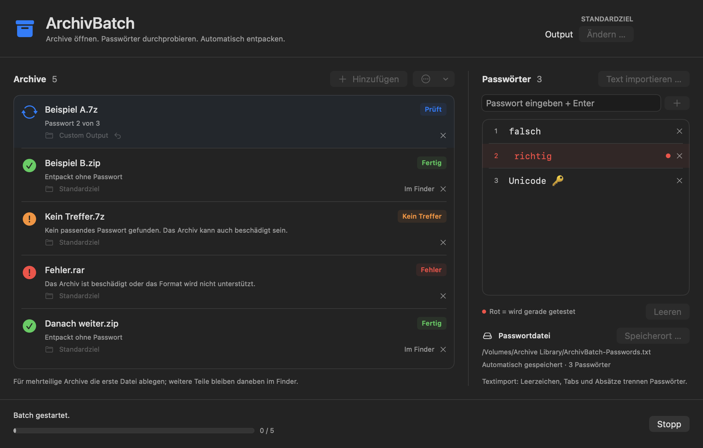

<div align="center">


# ArchivBatch

### Drop. Try. Unpack.

**A native Mac app for opening a queue of archives with the passwords you already have.**

[**Download for macOS**](https://github.com/powermac84/archivbatch/releases/latest/download/ArchivBatch-macOS-universal.zip) · [Quick start](#from-finder-to-finished) · [User guide](docs/usage.md) · [Build from source](#build-it-yourself)

[](https://github.com/powermac84/archivbatch/actions/workflows/ci.yml)


</div>

A folder full of archives. A handful of possible passwords. One place to work through both.

Drag files in from Finder, add your password candidates, and press **Start**. ArchivBatch tests each archive in order, highlights the current password in red, and extracts when the full archive test succeeds. If an archive cannot be opened, it marks the result and moves on.



## A small utility that handles the whole queue

| Feature | What it does |
| --- | --- |
| **Finder → queue** | Drop one archive or a batch of files into the same window. |
| **Your password list** | Add candidates with Enter or import text, including formatted RTF/RTFD. |
| **A visible attempt** | The password being tested turns red. Successful candidates record a hit. |
| **Remembered storage** | Keep the password list on a volume you choose. Confirm or change its path at startup. |
| **Output where you need it** | Choose a default extraction folder, with a separate destination for any archive. |
| **A queue that keeps going** | See successes, unmatched archives, and errors. Stop processing and restart unfinished items. |

7z, ZIP, RAR, and RAR5 are supported through the bundled **7-Zip 26.03** engine. Additional formats depend on 7-Zip's support. The app tries only the candidates you supply, beginning with an unencrypted check.

## From Finder to finished

1. **Choose the password file.** Pick its location on your Mac or a mounted volume. Changes to the list save automatically.
2. **Choose an extraction folder.** Drop your archives into the queue; set individual destinations where needed.
3. **Add the possibilities.** Enter passwords one by one or choose **Text importieren …** to import a text file.
4. **Press Start.** Watch the current attempt, then open completed output in Finder.

The current app interface is in **German**; this documentation is in English. See the [control reference and full guide](docs/usage.md).

Each completed archive gets a separate output folder. Existing destination files are preserved, and name collisions produce a new folder name. Unsuccessful extractions are kept out of the finished output.

## Install

Download the [latest universal ZIP](https://github.com/powermac84/archivbatch/releases/latest/download/ArchivBatch-macOS-universal.zip), unzip it, and move **ArchivBatch.app** to Applications.

- **Apple Silicon:** macOS 12 Monterey or later.
- **Intel:** macOS 14 Sonoma or later.

Release builds are signed locally with an **ad-hoc signature** and are **not notarized by Apple**. If macOS asks you to approve the app, verify the download source and use Apple's [per-app opening instructions](https://support.apple.com/guide/mac-help/open-a-mac-app-from-an-unknown-developer-mh40616/mac).

## Passwords stay in your workflow

Archive processing runs locally. The app has no account, upload, or network service. Each candidate is passed to the local `7zz` process as a command-line argument, so local process inspection may reveal the password being tested.

The password file is **plain text** at the location you choose. Text imports split at spaces, tabs, and line or paragraph breaks; formatting is discarded. Punctuation and case remain intact. Passwords entered manually retain their spaces when saved and reloaded. Exact duplicates are removed without merging different UTF-8 sequences.

If a volume is unavailable, the app keeps changes in memory and shows the save error. It asks before quitting with unsaved changes. External edits to the password file require an explicit reload before merging and saving. More in the [storage guide](docs/usage.md#keeping-a-password-list-on-a-volume).

## Build it yourself

Requires macOS and Xcode or the Xcode Command Line Tools.

```sh
git clone https://github.com/powermac84/archivbatch.git
cd archivbatch
/bin/bash build.sh
```

The build creates `dist/ArchivBatch.app` for Apple Silicon and Intel, bundles the extraction engine and license notices, and verifies the local signature.

Run the archive and password-storage regression suites:

```sh
/bin/bash Tests/run-engine-tests.sh
/bin/bash Tests/run-password-tests.sh
```

The suites contain **32 integration tests**, including real encrypted 7z, AES-ZIP, ZipCrypto, RAR4, and RAR5 archives; exact extracted-content checks; output collisions; cancellation; Unicode; storage across a process restart; missing volumes; and external file edits. A [native UI check](CONTRIBUTING.md#validation) exercises the batch model and renders the interface.

Runtime and UI verification has been performed on Apple Silicon. The Intel build is compiled and its architecture is checked; it has not been run on Intel hardware.

## License & credits

ArchivBatch's app source is released under the [MIT license](LICENSE).

The bundled 7-Zip engine is a separate component by **Igor Pavlov**, distributed under its own GNU LGPL, BSD, and unRAR terms. Its [original license notice](Vendor/License.txt), [LGPL text](LICENSES/LGPL-2.1.txt), and corresponding source archive are included. The small RAR regression fixtures come from [libarchive](Tests/README.md).

[Release history](CHANGELOG.md) · [Contributing](CONTRIBUTING.md) · [Report an issue](https://github.com/powermac84/archivbatch/issues)
